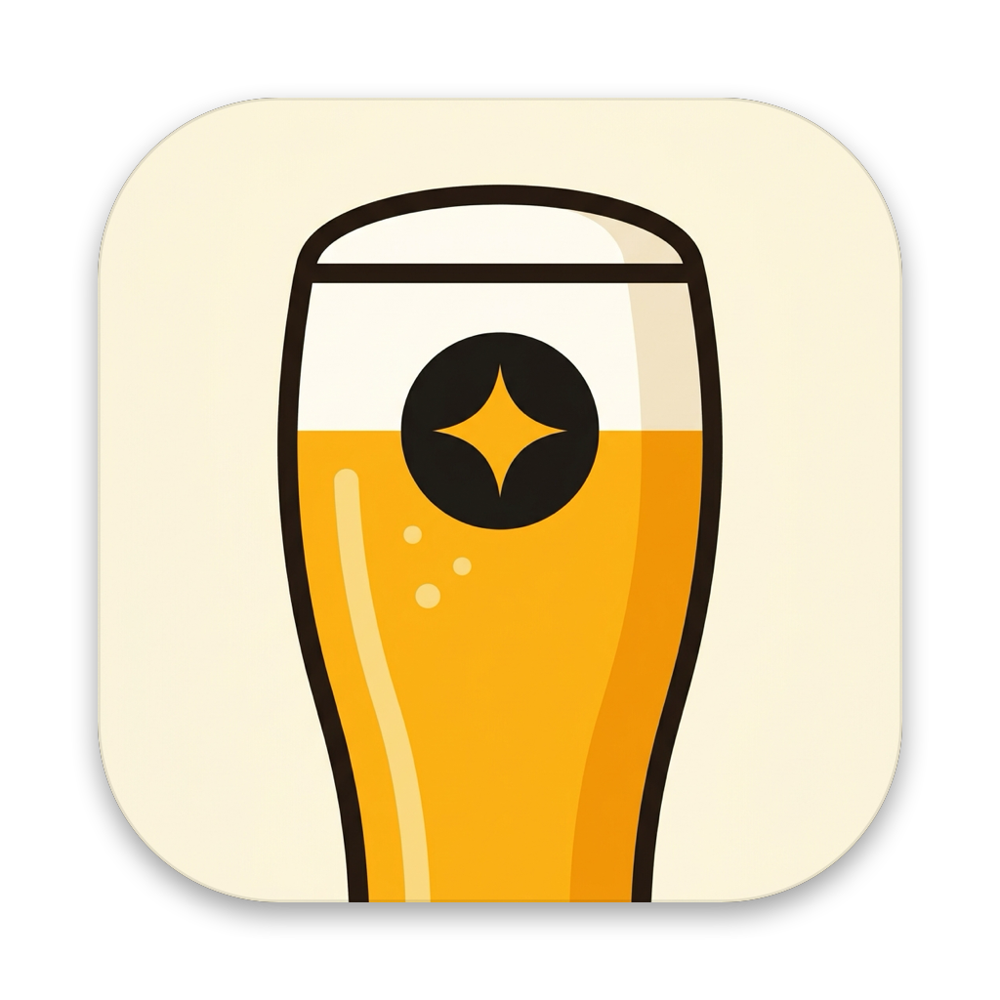

<p align="center">
  
</p>

<h1 align="center">Quota</h1>

<p align="center">
  A lightweight, native macOS menu bar indicator for <b>OpenAI Codex</b> and <b>Google Antigravity</b> subscription usage and reset countdowns.
</p>

## Install (Apple Silicon)

### Option 1: Homebrew (Recommended — No Gatekeeper Warning)

```bash
brew tap yeoleobun/tap
brew trust yeoleobun/tap 2>/dev/null || true
brew install --cask yeoleobun/tap/quota
```

### Option 2: One-Line Terminal Installer

```bash
curl -fsSL https://raw.githubusercontent.com/yeoleobun/Quota/main/scripts/install.sh | zsh
```

### Option 3: Manual `.dmg` Download

1. Download **`Quota-macos-arm64.dmg`** from the [latest GitHub Release](https://github.com/yeoleobun/Quota/releases/latest) and drag **`Quota.app`** into `/Applications`.
2. Clear the browser quarantine flag once before first launch:
   ```bash
   xattr -cr /Applications/Quota.app
   open /Applications/Quota.app
   ```

## Features

- **Native macOS Menu (`NSMenu`):** Uses AppKit's genuine system menu (`statusItem.menu`) so backdrop translucency, section headers, badges, checkmarks, and hover highlights match macOS natively.
- **Weekly Watermark Status Dot:** Displays a monochrome menu bar beer mug icon (`isTemplate = true`) with an optional **Green / Yellow / Red** corner dot reflecting the active agent's weekly quota watermark:
  - **Green:** `> 25%` remaining
  - **Yellow:** `11% – 25%` remaining
  - **Red:** `<= 10%` remaining
- **Hover or Click to Reveal:** Hover over the menu bar icon to glance at remaining percentages, ring gauges, and reset timers — move your cursor away to auto-dismiss, or click to keep the menu pinned.
- **Zero Credentials Stored:** Reads live usage directly from your existing local CLI sessions (`codex app-server --stdio` bundled in `ChatGPT.app` and `~/.local/bin/agy` `/usage`) with resilient cached fallback if a refresh fails.

## Requirements

- macOS 26.0+ on Apple Silicon (`arm64`)
- One or both supported tools signed in locally:
  - **OpenAI Codex** (`/Applications/ChatGPT.app` or `codex` CLI)
  - **Google Antigravity** (`~/.local/bin/agy`)

## Build from Source

```bash
./scripts/build-app.sh
open dist/Quota.app
```

## Run Tests

```bash
swift test
```

## Project Structure

- `Assets/` — App bundle icon (`AppIcon.png`, `AppIcon.icns`)
- `Sources/QuotaBarApp/` — Native AppKit menu bar item, hover tracking, and `NSMenu` UI
- `Sources/QuotaBarCore/` — `CodexProvider`, `AntigravityProvider`, models, and polling store
- `Tests/QuotaBarTests/` — Parser and resilient state merge unit tests
- `scripts/` — App bundle packager (`build-app.sh`), 1-line installer (`install.sh`), and `.icns` generator (`generate-icons.swift`)
- `.github/workflows/release.yml` — Automated Apple Silicon (`arm64`) release pipeline on `v*` tags
